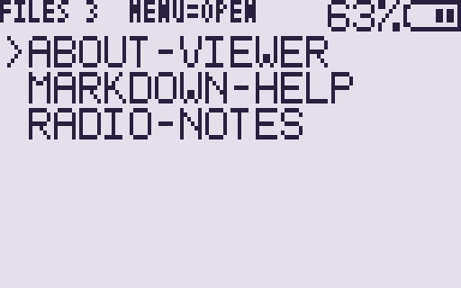
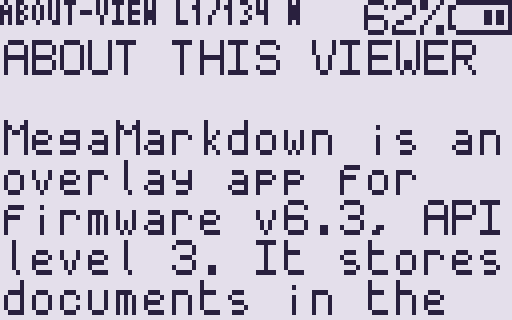
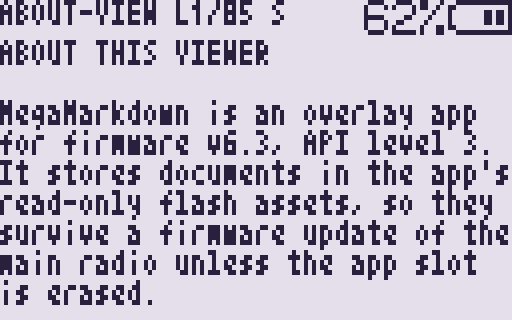

# MegaMarkdown — Markdown viewer for UV-K1 / UV-K5 v3 by MegaSaturnv

**MegaMarkdown** is a portable overlay app that reads Markdown documents on the
[armel/uv-k1-k5v3-firmware-custom](https://github.com/armel/uv-k1-k5v3-firmware-custom)
firmware, targeting **v6.3.0, ABI 1, API level 3**.

With the amount of apps people are developing, I wanted a way to view their readme files on the device. I would have liked to develop this by hand, but due to time constraints AI has been used for most of the code and then reviewed. This will allow me more time to study API level 4. Over time I would like to minimise this app as much as possible to allow room for more markdown files. Most of the text below this line is AI-written, with a few tweaks.





---
## Adding Markdown Files

The documents live in [`markdown files/`](markdown%20files/). At build time each
file is converted to 18-column display lines, compressed with a small LZSS
codec, and packed into the app's read-only flash assets. The radio app then
decompresses only the lines it draws. Press `0` in the reader to switch to the
radio's 3x5 font, which reflows the same text to 32 columns and nine rows.

This folder vendors the v6.3.0 SDK and the ARM toolchain installer, so it builds
without cloning the firmware. It is also usable inside the firmware tree as
`App/apps/markdown_viewer/`.

## Quick Start

```sh
./tools/fetch-toolchain.sh   # once; installs ./.toolchain (gitignored)
./build.sh                   # or: make
```

The toolchain step is skipped automatically if `arm-none-eabi-gcc` is already on
`PATH` (or `TOOLCHAIN_ROOT` points at one). Output:

```
markdown_viewer/MegaMarkdown.app
```

Install that file with **UV Studio → Apps → Community → Install a .app**, choose
a free slot, then open the Apps menu on the radio (`F` then `7`), select
**MegaMarkdown** and press `MENU`.

## Layout

```
.
├── build.sh                  convenience wrapper
├── Makefile                  make / make clean / make toolchain
├── markdown files/           source documents (*.md, *.markdown)
├── markdown_viewer/          the app itself
│   ├── markdown_viewer_app.c entry point, list, reader, LZSS decoder
│   ├── app.ld                linker script: everything in the 4 KiB overlay
│   ├── gen_assets.py         Markdown -> display lines + tiny markers -> assets
│   ├── lzss.py               compressor (the decoder is in the C file)
│   ├── build.sh              compile, link, pack
│   ├── MegaMarkdown.app      build output (gitignored)
│   └── markdown_assets.*     generated at build time (gitignored)
├── sdk/                      unmodified v6.3.0 SDK files (see sdk/README.md)
├── test/                     host decoder/renderer comparison
└── tools/fetch-toolchain.sh  installs ./.toolchain locally
```

## Changing the documents

Put `.md` or `.markdown` files in `markdown files/` (the folder is flat; hidden
files are ignored) and rebuild:

```sh
make clean
./build.sh
```

The build prints one row per document:

```
SOURCE                     TEXT  PACKED LINES  NAME
about-viewer.md            1429    1069   100  ABOUT-VIEWER
markdown-help.md           1094     894    84  MARKDOWN-HELP
radio-notes.md             1338    1083   105  RADIO-NOTES

Assets: 3046 / 3840 B (79%)
```

The asset area holds **3840 bytes** of compressed documents. If the total is
larger, the build stops with the exact size; remove or trim documents and
rebuild. The display name is the filename without its extension, uppercased and
limited to 16 characters (duplicates get `~2`, `~3`, ...).

Every source file is rendered at build time, not on the radio:

| Markdown | Result on the radio |
| --- | --- |
| `# Heading` | Uppercase heading, separated by blank lines |
| `- item`, `1. item` | `- item`, `1. item` |
| `> quote` | `> quote` |
| `**bold**`, `*italic*`, `` `code` `` | Markers removed |
| `[text](url)`, `` | Visible text only |
| fenced code block | Plain lines, hard-wrapped |
| `---` | A line of dashes |
| table rows | Cells joined with `|` |

Long paragraphs are word-wrapped to 18 columns; a word longer than that is
split. Non-ASCII characters become `?`, because the radio font covers printable
ASCII.

## Controls

| Key | File list | Reader |
| --- | --- | --- |
| `UP` / `DOWN` (or `LEFT` / `RIGHT` on K1) | previous / next file | scroll one line |
| `MENU` | open the selected file | back to the file list |
| `0` | — | toggle normal (18-column) / tiny (32-column) font |
| `STAR` | first file | jump to the top |
| `F` | last file | jump to the bottom |
| `EXIT` | quit to the Apps menu | quit to the Apps menu |

Held keys repeat, except `0`, which toggles once per press. The screen saver is
enabled; any key wakes the display and redraws it.

## Compression choice

gzip/deflate compresses text better than LZSS, but an inflate decoder would take
a large part of the 4 KiB overlay code budget. This app uses LZSS with a 1 KiB
window and 16-bit tokens: the decoder is a few hundred bytes of C, and the
window is the only large object in `.bss`. Measured on a 6.7 KiB text sample,
gzip reached about 48% while this LZSS reached about 69%. On the bundled
documents, 3711 bytes of normal-view text become 3046 bytes of assets; zlib
would be about 2012 bytes. That 1034-byte asset saving is smaller than the code
an inflate decoder would add, and this build has only 380 bytes of overlay
headroom left. The LZSS trade-off leaves room for the viewer, the list and the
tiny-font reflow; use larger source documents only if the compressed total
stays under the limit.

## Limits worth remembering

- **4 KiB total** for code, constants, initialised data and `.bss` (the linker
  assert enforces it). The current build uses 3716 B, including the LZSS window
  and the tiny-font wrap buffer.
- **Assets**: at most 3840 bytes, read with `asset_read()`; this app requires
  API level 2 for assets and API level 3 for the rest of its build.
- **No firmware symbols and no C library**: only `libgcc` is linked. The app
  forwards the resident division helpers, so constant division in the status
  line is free of libgcc's larger routines.
- **Never write flash**: this app does not call any persistence service. The
  documents are read-only assets; a build update replaces them with the app.
- **No transmit path**: the app never keys the radio and changes no radio
  settings. It only turns the LED off at entry and exit.
- `APP_API_MIN=3` means the app is refused by firmware older than API level 3.
  The v6.3.0 overlay apps run on the **Labs** and **Fusion_** presets; the plain
  Fusion preset does not enable `ENABLE_FEAT_F4HWN_OVERLAY_APPS`.

## Building inside the firmware tree

Copy `markdown_viewer/` to `App/apps/markdown_viewer/`, then point
`MARKDOWN_DIR` at this repository's `markdown files/` folder and run the app's
`build.sh`:

```sh
cd App/apps/markdown_viewer
MARKDOWN_DIR=/path/to/markdown\ files \
TOOLCHAIN_ROOT=/path/to/project/.toolchain ./build.sh
```

`build.sh` and `gen_assets.py` detect the parent directory's `pack_app.py` and
`app_overlay.h` instead of `../sdk`. The firmware's `compile-app.sh` also works
if the SDK files and documents are copied alongside the app.

## Renaming / making it your app

1. Change `APP_NAME` and `APP_VER` in `markdown_viewer/build.sh`.
2. Update the README title and the `MegaMarkdown` references.
3. Replace the documents. If you use a different font width, change `LINE_COLS`
   and `TINY_COLS` in `markdown_viewer/gen_assets.py`; `MD_ROWS` must stay 7,
   because the LCD's top row is the separate status line and only seven rows
   belong to the frame buffer. `TINY_ROWS` must stay 9 for the 3x5 font.
4. Keep the LZSS constants in `lzss.py` and the generated header in sync; the
   generator writes the header, so edit `lzss.py` only.

The app name is shown on the radio and in UV Studio, is limited to 15
characters, and must not match an official app.

## Portability

- `.toolchain/` stays inside the directory on disk (gitignored), so a copy on
  the same host architecture builds without network access.
- On a different architecture, `./tools/fetch-toolchain.sh` replaces it with the
  matching ARM GNU 13.3.rel1 toolchain.
- Build outputs, generated assets and `__pycache__` are gitignored; the SDK and
  document sources are tracked.

## Verification

- The build was verified with the pinned ARM GNU 13.3.rel1 toolchain against the
  vendored v6.3.0 headers.
- `make test` runs a host-side decoder test: it decodes every generated stream
  in both the normal and tiny layouts. The normal output matches the Python
  renderer exactly (289 lines), and the tiny layout decodes 201 rows without
  errors or overlong lines.
- `make test` uses a temporary patched `app_api.h` because the SDK's 32-bit
  layout asserts do not hold on a 64-bit host. The test copies the header to a
  temporary directory and removes only those `_Static_assert` offset checks
  before compiling; the radio build always uses the unmodified SDK header.
- The blob header reports ABI 1, API minimum 3, no required capabilities, a
  valid code CRC, a valid asset CRC and `app_main` at offset 0.
- It has not been run on radio hardware. Test on a radio before publishing.

Overlay apps run privileged native code with no sandbox. Only install apps you
trust. See `LICENSE` (Apache-2.0).
